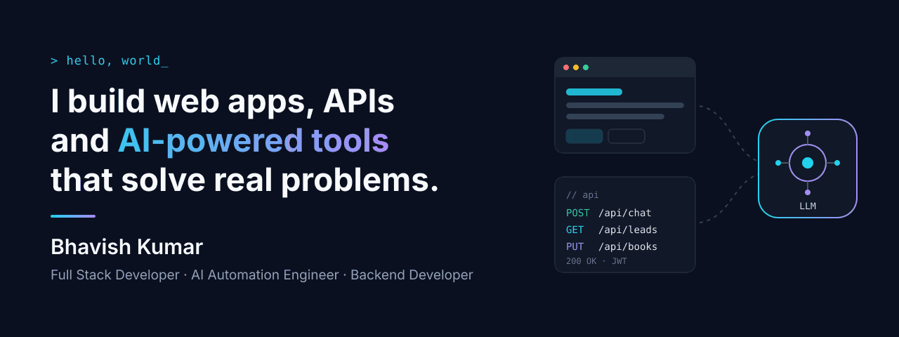

  

  <a href="https://bhavishkumar-portfolio.netlify.app/">Portfolio</a> ·
  <a href="https://www.linkedin.com/in/bhavish-kumar-ab40a9303">LinkedIn</a> ·
  <a href="mailto:bhavishkumar799@gmail.com">Email</a>
  <!-- · <a href="UPWORK_URL">Upwork</a> · <a href="FIVERR_URL">Fiverr</a> -->

## Hi, I'm Bhavish 👋

I'm a **Full Stack Developer** from Hyderabad, Pakistan. I build complete web applications, from the React interface to the API and database behind it, and I connect them to large language models when AI makes the product more useful.

- 🧩 I've built a CRM, a library management system, an AI interview practice platform and an AI student assistant.
- 🤖 I integrate LLMs (Google Gemini, Groq) into real apps, and I design them to say "I don't know" instead of inventing answers.
- 🎓 I'm finishing my BS in Computer Science and I'm open to **remote roles and freelance projects**.

## 🛠️ Tech stack

**Frontend**

**Backend & databases**

**AI & integration:** LLM APIs (Google Gemini, Groq) · retrieval over custom data · REST APIs · JWT authentication

**Tools**

## 🚀 Featured projects

### [AI Interview Assistant](https://github.com/Bhavish295/AI-Interview-Assistant)
**Practice job interviews and get instant AI feedback.**
Candidates pick a track (software engineering, DSA, system design, data science, behavioral and more), answer by typing or speaking, and Google Gemini scores each answer with short tips. Users can upload a resume PDF for an AI summary and track their scores over time.

`Next.js 15` `TypeScript` `MongoDB` `Gemini API` `Tailwind CSS` `JWT`

### [SZABIST AI Student Assistant](https://github.com/Bhavish295/SZABIST-AI-CHATBOT)
**An AI assistant that answers student questions using official university data.**
It answers questions about admissions, programs, fees, campus, policies and class timetables for SZABIST Hyderabad. Answers are grounded in stored university data through a retrieval step, and missing facts are flagged as unverified rather than made up. It has both a terminal chatbot and a responsive React web app with dark mode.

`Python` `Groq LLM` `Retrieval` `React` `Vite`

### [Smart Business CRM](https://github.com/Bhavish295/Smart-business-CRM)
**A CRM for small businesses to manage their sales pipeline.**
It tracks leads from New to Won, converts them into clients, schedules follow-ups and manages team roles. A dashboard and reports show conversion rates with charts.

`React 19` `Node.js` `Express 5` `PostgreSQL (Supabase)` `JWT`

### [SZABIST Smart Digital Library](https://github.com/Bhavish295/Szabist-library-management-system)
**A full library system with separate student and librarian portals.**
Students can search the catalogue, reserve books, join a waitlist that promotes them automatically (with an email alert) when a copy is returned, renew books and download e-books. Librarians manage books, issues, returns and fines, with analytics and CSV export. Integration tests use Jest and Supertest.

`React` `Node.js` `Express` `SQLite` `Jest`

## 📫 Let's work together

I'm available for **remote junior developer roles** and **freelance projects**, including web apps, REST APIs, dashboards and AI chatbots.
The best way to reach me is by [email](mailto:bhavishkumar799@gmail.com) or on [LinkedIn](https://www.linkedin.com/in/bhavish-kumar-ab40a9303).
